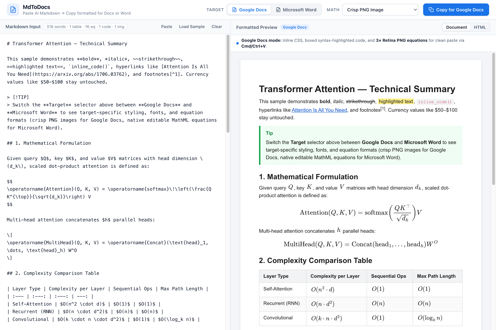
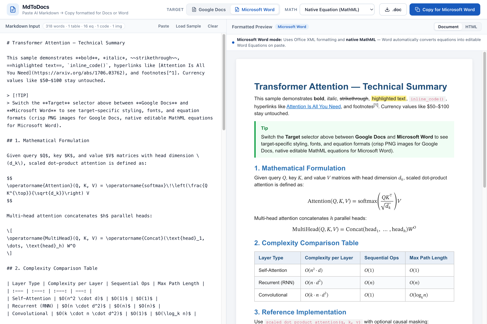
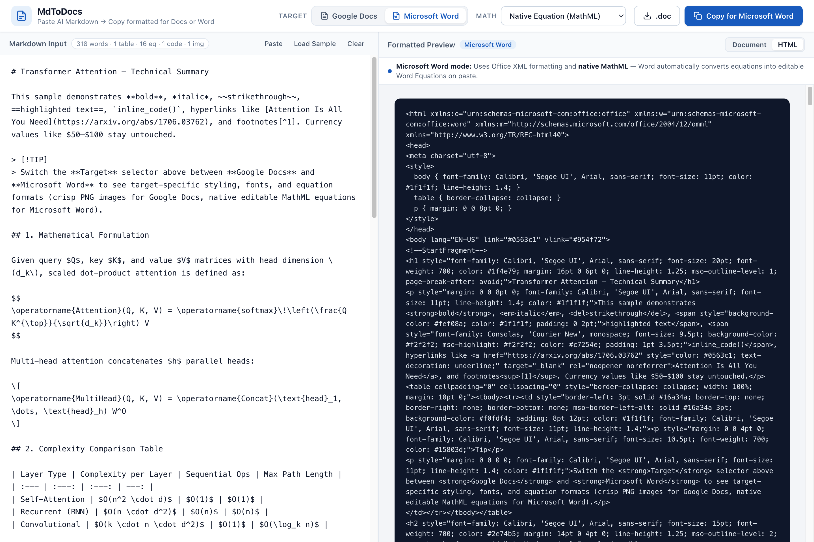

# MD2Docs

**Paste Markdown from any AI agent &rarr; Copy cleanly formatted for Google Docs or Microsoft Word.**

MD2Docs is a zero-build, single-page static web tool designed specifically for the rich Markdown produced by AI assistants (ChatGPT, Claude, Gemini, etc.) — including LaTeX math equations, GFM tables, syntax-highlighted code blocks, callout alerts, images, task lists, and footnotes.


---

## Screenshots

### Google Docs Mode
Inline styles on every element, boxed syntax-highlighted code, callout blocks, bordered tables, and **3× Retina PNG equations** that paste cleanly into Google Docs with `Cmd/Ctrl + V`.



### Microsoft Word Mode
Switch the target selector to **Microsoft Word** for Word-native heading levels, Calibri/Consolas styling, **native editable MathML equations** (automatically converted to Word OMML equations on paste), and one-click `.doc` export.



### Built-in HTML Source Inspector
Inspect the exact inline-styled clipboard HTML (including Microsoft Office XML namespaces and `<!--StartFragment-->` markers) directly in the preview pane.



---

## Target Comparison: Google Docs vs. Microsoft Word

| Feature | Google Docs Mode | Microsoft Word Mode |
| :--- | :--- | :--- |
| **Typography** | Arial (`11pt`), Docs heading hierarchy (`H1`–`H6`) | Calibri (`11pt`), Word heading colors & `mso-outline-level` |
| **Math Equations (Default)** | **3× Retina PNG images** (rendered client-side via MathJax SVG &rarr; Canvas) | **Native MathML** (Word auto-converts to editable Office Math / OMML on paste) |
| **Alternative Math Modes** | Editable Unicode + `<sup>`/`<sub>`, or Raw LaTeX (`$$...$$`) | 3× Retina PNG (great for Word Online), Editable Unicode, or Raw LaTeX |
| **Code Blocks** | Shaded bordered table, inline Highlight.js syntax colors, `&nbsp;` indentation | Same + Consolas font and `mso-border-alt` borders |
| **Inline Code** | Monospace shaded inline `<span>` | Monospace shaded `<span>` with `mso-highlight` |
| **Tables** | Explicit inline borders, column alignment, header shading, zebra striping | Same + Word `1pt` / `mso-border-alt` borders |
| **Blockquotes & Alerts** | Left-accented single-cell table (`NOTE`, `TIP`, `IMPORTANT`, `WARNING`, `CAUTION`) | Same + `mso-border-left-alt` |
| **Images** | Remote URLs & data URIs; inline SVG data URIs auto-rasterized to PNG | Same |
| **Clipboard Payload** | Clean inline-styled HTML fragment | Full Office-namespaced HTML (`xmlns:o`, `xmlns:w`, `xmlns:m`) + `.doc` download |

---

## Supported Markdown Elements

- **Math Equations**: Supports all common AI-agent delimiters — `$inline$`, `$$display$$`, `\(inline\)`, and `\[display\]` — while safely ignoring currency values (e.g., `$50–$100`) and anything inside code blocks or inline code.
- **Tables**: GitHub Flavored Markdown tables with borders, header shading, and inline math/code inside cells.
- **Code Blocks & Inline Code**: Fenced code blocks (` ```lang ` / `~~~`) with automatic Highlight.js syntax highlighting converted to inline CSS colors and exact indentation preservation.
- **Images**: Standard Markdown images (``) and HTML `` tags. Image titles automatically render as centered italic captions, and inline `data:image/svg+xml` diagrams are rasterized to high-DPI PNGs so Google Docs and Word preserve them on paste.
- **Rich Text**: Headings (`H1`–`H6`), **bold**, *italic*, ~~strikethrough~~, `==highlights==`, `<kbd>` keys, hyperlinks, nested ordered/unordered lists, Unicode task lists (`- [x]` &rarr; `☑`, `- [ ]` &rarr; `☐`), GitHub-style alerts (`> [!NOTE]`, `> [!TIP]`, `> [!IMPORTANT]`, `> [!WARNING]`, `> [!CAUTION]`), horizontal rules, and numbered footnotes (`[^1]`).

---

## Quick Start

No build step or dependencies to install:

1. **Open directly in your browser**: double-click [`index.html`](index.html), or
2. **Serve locally**:
   ```bash
   python3 -m http.server 8000
   ```
   Then open `http://localhost:8000`.
3. **Host anywhere**: deploy directly to **GitHub Pages** (`Settings → Pages → Branch: main / root`), Netlify, Cloudflare Pages, or any static host.

### Keyboard Shortcuts & Workflow

- **Paste** Markdown into the left editor (or drag and drop a `.md` / `.txt` file).
- Choose **Google Docs** or **Microsoft Word** in the top bar.
- Click **Copy for Google Docs** / **Copy for Microsoft Word** (or press `Cmd/Ctrl + Shift + C`).
- Paste directly into your Google Doc or Word document with `Cmd/Ctrl + V`.

### URL Query Parameters

You can deep-link directly into a specific mode:

| Parameter | Values | Example |
| :--- | :--- | :--- |
| `target` | `gdocs`, `word` | `?target=word` |
| `math` | `png`, `mathml`, `unicode`, `latex` | `?target=gdocs&math=unicode` |
| `view` | `rendered`, `html` | `?target=word&view=html` |
| `sample` | `1` | `?sample=1` (loads built-in sample, ignoring `localStorage`) |

---

## Repository Structure

```text
.
├── index.html              # Static entry page & CDN scripts (Marked, DOMPurify, Highlight.js, MathJax)
├── styles.css              # UI layout & responsive document-preview styles
├── app.js                  # Preprocessor, MathJax renderers, inline-style DOM converters, clipboard/export
├── AGENTS.md               # Root guidance and invariants for AI coding agents
├── README.md               # Project overview & usage guide
└── docs/
    ├── ARCHITECTURE.md     # Deep dive into the 6-stage conversion pipeline & Docs/Word paste quirks
    ├── AGENT_WORKFLOW.md   # Step-by-step playbook for AI agents extending or testing this repo
    └── screenshots/        # Live Retina screenshots used in documentation
```

---

## Working with AI Agents

This repository includes dedicated agent documentation so AI coding assistants can contribute safely and consistently:

- **[`AGENTS.md`](AGENTS.md)** — Core invariants, constraints, and verification rules.
- **[`docs/ARCHITECTURE.md`](docs/ARCHITECTURE.md)** — Full conversion pipeline and Google Docs / Microsoft Word HTML compatibility notes.
- **[`docs/AGENT_WORKFLOW.md`](docs/AGENT_WORKFLOW.md)** — Practical recipes for adding features, debugging paste issues, testing, and regenerating screenshots.
